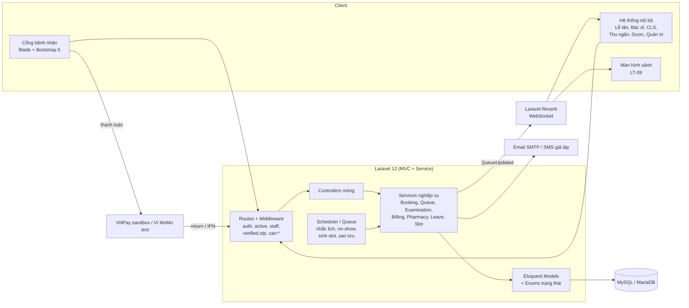
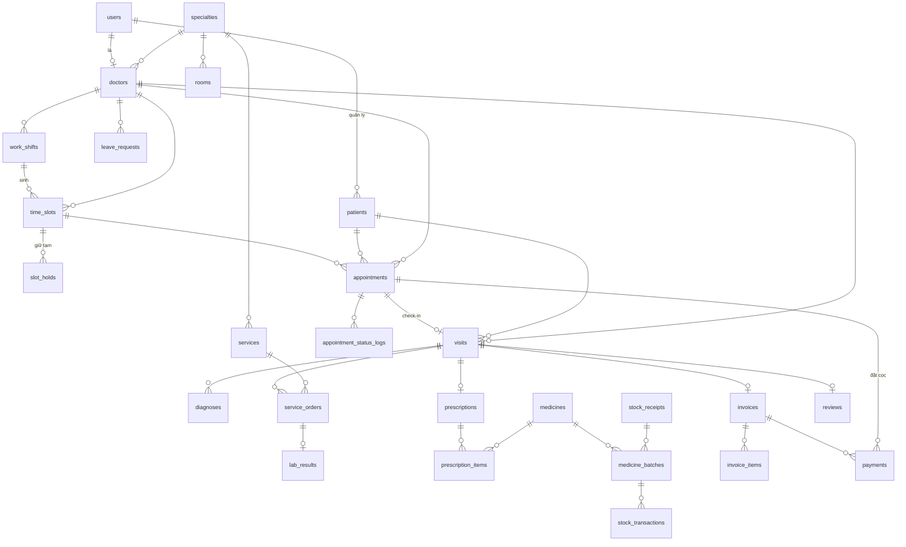
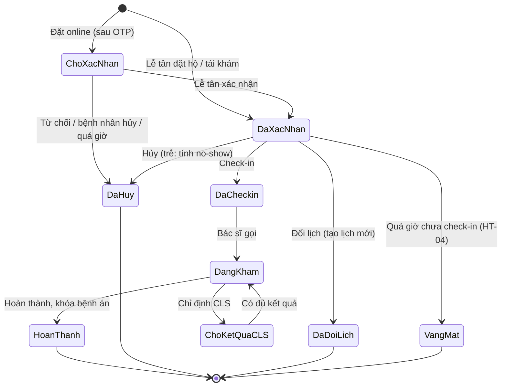

# Thiết kế hệ thống

Tài liệu tóm tắt kiến trúc, cơ sở dữ liệu và các luồng xử lý chính của hệ thống quản lý phòng khám và đặt lịch khám trực tuyến. Các sơ đồ viết bằng Mermaid (xem trực tiếp trên GitHub/VS Code hoặc dán vào https://mermaid.live).

## 1. Kiến trúc tổng thể



Nguyên tắc: controller chỉ nhận request, kiểm tra dữ liệu và gọi service; toàn bộ quy tắc nghiệp vụ (BR-xx) nằm trong `app/Services`. Vi phạm quy tắc ném `BusinessRuleException`, được hiển thị thành thông báo thân thiện (hoặc JSON 422 với AJAX).

| Thư mục | Nội dung |
|---|---|
| `app/Enums` | Trạng thái lịch hẹn (9 trạng thái), lượt khám, chỉ định, đơn thuốc, hóa đơn, thanh toán, vai trò |
| `app/Services` | `BookingService`, `AppointmentWorkflow`, `QueueService`, `ExaminationService`, `BillingService`, `PharmacyService`, `LeaveService`, `SlotGenerator`, `OtpService`, `VnpayService` |
| `app/Console/Commands` | Tác vụ tự động HT-01, HT-03, HT-04, HT-10, QT-09 và lệnh kiểm thử tranh chấp `clinic:race-test` |
| `app/Http/Controllers/Client/Site` | Trang công khai, API slot trống, gợi ý chuyên khoa, màn hình sảnh |
| `app/Http/Controllers/Client/Account` | Cổng bệnh nhân |
| `app/Http/Controllers/Admin` | Hệ thống nội bộ, chia thư mục con theo vai trò: `Reception`, `Doctor`, `Lab`, `Cashier`, `Pharmacy`, `Management` |
| `app/Support` | Cấu hình quy tắc (`Settings`), quyền (`Permissions`), QR, audit log |

## 2. Cơ sở dữ liệu

Ánh xạ thực thể trong tài liệu phân tích sang bảng:

| Thực thể | Bảng | Ghi chú |
|---|---|---|
| TaiKhoan | `users` | Dùng chung bệnh nhân và nhân viên, phân biệt bằng vai trò (spatie/laravel-permission) |
| BenhNhan | `patients` | Một tài khoản quản lý nhiều hồ sơ; vãng lai có `user_id = null`; `allergies`, `medical_history` mã hóa |
| NhanVien/BacSi | `users` + `doctors` | Hồ sơ chuyên môn bác sĩ tách riêng |
| ChuyenKhoa, PhongKham | `specialties`, `rooms` | |
| CaLamViec, KhungGio | `work_shifts`, `time_slots` | Slot sinh từ ca; `booked_count` cập nhật trong transaction có khóa dòng |
| (giữ chỗ tạm) | `slot_holds` | HT-01: giữ chỗ trong lúc chờ OTP |
| LichHen | `appointments` + `appointment_status_logs` | Mỗi lần chuyển trạng thái ghi người thực hiện, thời điểm |
| LuotKham | `visits` + `visit_addenda` | Tách khỏi lịch hẹn; bổ sung bệnh án sau khi khóa |
| ChanDoan | `diagnoses` | Mã ICD-10, một bệnh chính |
| DichVu, ChiDinh, KetQuaCLS | `services`, `service_orders`, `lab_results` | |
| Thuoc, LoThuoc | `medicines`, `medicine_batches`, `stock_receipts`, `stock_transactions` | Thẻ kho ghi mọi biến động |
| DonThuoc, ChiTietDonThuoc | `prescriptions`, `prescription_items` | |
| HoaDon, ThanhToan | `invoices`, `invoice_items`, `payments` | Thanh toán gồm thu tiền, đặt cọc online, hoàn tiền |
| ThongBao | `notifications` | Laravel database notifications |
| DanhGia | `reviews` | |
| (cấu hình BR) | `settings` | Ghi đè tham số mặc định ở `config/clinic.php` |
| (audit log) | `activity_log` | spatie/laravel-activitylog |



Ràng buộc quan trọng:

- `time_slots (doctor_id, date, start_time)` unique: sinh slot nhiều lần không bị trùng.
- `visits (doctor_id, visit_date, queue_number)` unique: số thứ tự không trùng trong ngày.
- `visits.appointment_id`, `invoices.visit_id`, `prescriptions.visit_id`, `reviews.visit_id` unique: quan hệ 1-1.

## 3. Vòng đời lịch hẹn



Cài đặt: `App\Enums\AppointmentStatus::allowedTransitions()` và `App\Services\AppointmentWorkflow::transition()`. Chuyển trạng thái không hợp lệ bị từ chối.

## 4. Luồng đặt lịch và chống đặt trùng (BR-01, HT-01, HT-02)

```mermaid
sequenceDiagram
    actor BN as Bệnh nhân
    participant C as BookingController
    participant S as BookingService
    participant DB as MySQL
    BN->>C: Chọn slot + hồ sơ + triệu chứng
    C->>S: hold(user, patient, slot)
    S->>DB: BEGIN; SELECT * FROM time_slots WHERE id=? FOR UPDATE
    Note over S,DB: Request đến sau phải chờ khóa dòng
    S->>S: Kiểm tra BR-02, BR-03, BR-05
    S->>DB: Đếm booked_count + slot_holds còn hạn < capacity?
    S->>DB: INSERT slot_holds (expires_at = now + 10 phút); COMMIT
    S-->>BN: Gửi OTP (email / SMS)
    BN->>C: Nhập OTP (trước khi hết hạn giữ chỗ)
    C->>S: confirmHold(hold, otp)
    S->>DB: BEGIN; SELECT ... FOR UPDATE (slot)
    S->>DB: INSERT appointments; UPDATE time_slots SET booked_count+1; DELETE hold; COMMIT
    S-->>BN: Mã lịch hẹn + QR, thông báo
```

Kiểm chứng: `php artisan clinic:race-test --n=20` chạy 20 tiến trình đặt đồng thời cùng một slot; số lịch thành công luôn bằng sức chứa. Kiểm thử tự động: `tests/Feature/BusinessRulesTest.php`.

## 5. Hàng đợi (BR-06, LT-08, HT-06)

Thứ tự gọi = bệnh nhân ưu tiên (người cao tuổi, trẻ nhỏ, hoặc lễ tân đánh dấu) trước, sau đó theo `queue_sort`:

| Trường hợp | `queue_sort` |
|---|---|
| Có lịch hẹn, đến đúng giờ hoặc sớm | Giờ hẹn |
| Bệnh nhân vãng lai | Giờ check-in |
| Có lịch hẹn nhưng trễ quá 15 phút (BR-06) | Giờ check-in (xuống cuối hàng) |
| Lễ tân "đẩy xuống cuối" hoặc gọi không có mặt | Thời điểm thao tác |

Mỗi thay đổi phát sự kiện `QueueUpdated` qua Laravel Reverb. Màn hình lễ tân, bác sĩ và sảnh tự cập nhật; nếu Reverb không chạy, giao diện tự làm mới bằng polling.

## 6. Phân quyền (RBAC)

| Quyền | Lễ tân | Bác sĩ | KTV CLS | Thu ngân | Dược sĩ | Quản trị |
|---|:-:|:-:|:-:|:-:|:-:|:-:|
| appointments.view / manage | ✔ | xem | | | | ✔ |
| reception.manage | ✔ | | | | | ✔ |
| patients.view / manage | ✔ | xem | | xem | | ✔ |
| medical.examine / view | | ✔ | | | | ✔ |
| leave.request | | ✔ | | | | ✔ |
| lab.manage | | | ✔ | | | ✔ |
| billing.manage | | | | ✔ | | ✔ |
| pharmacy.dispense / inventory.manage | | | | | ✔ | ✔ |
| catalog / schedule / staff / settings / reports / reviews / audit | | | | | | ✔ |

Ma trận có thể chỉnh trong màn hình Phân quyền (QT-02). Bệnh nhân chỉ truy cập được hồ sơ do tài khoản mình quản lý (BR-09).
